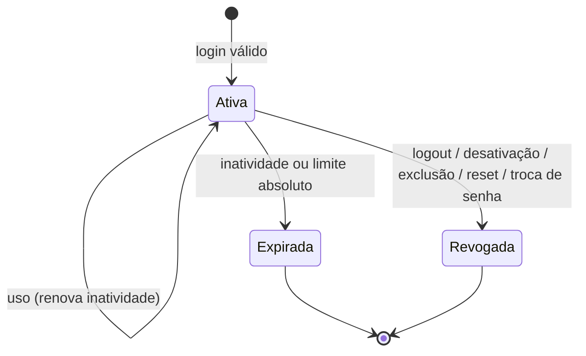
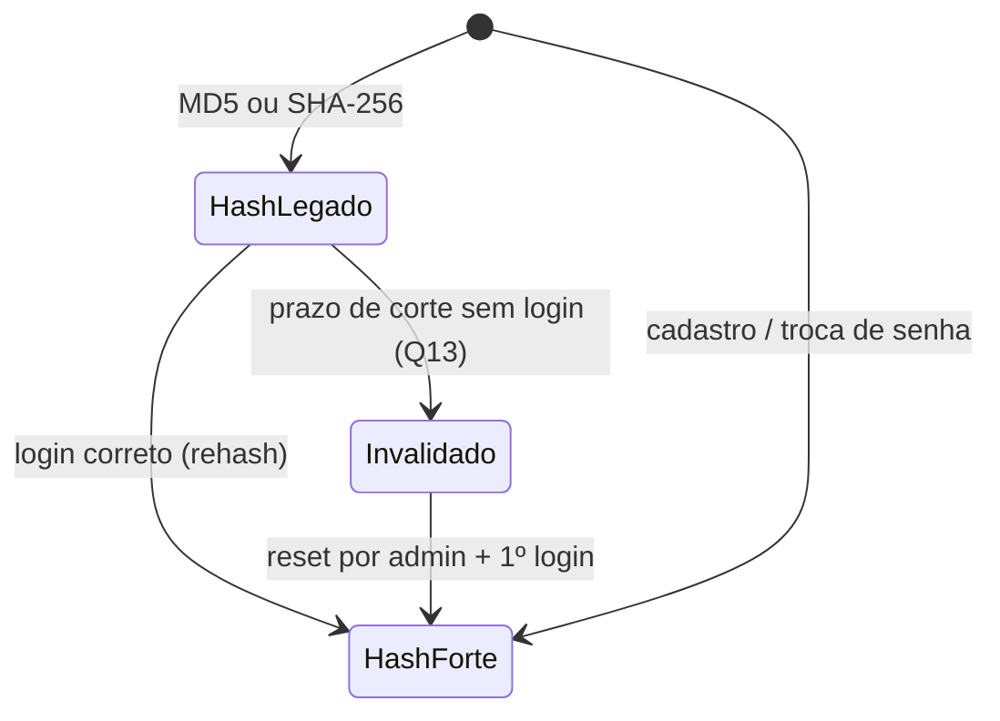

# 010 – Autenticação e autorização no servidor

**Status:** rascunho (aguardando aprovação do dono; nenhum código deve ser escrito antes)
**Autor / data:** arquiteto-specs (rascunho a pedido de Caio Maia) / 2026-10-13
**Substitui na prática:** os riscos registrados em [001](001-autenticacao-usuarios.md), [004](004-reservas.md), [005](005-dashboard-visualizacao-publica.md) e os itens 1 a 3 de "Pontos de atenção" de [architecture.md](../architecture.md). Ao ser implementada, 001, 004 e 005 recebem nota de atualização.

Convenção desta spec: `[PREMISSA: ...]` = assumi, vale até o dono dizer o contrário; `[PENDENTE: ...]` = precisa de decisão do dono; todas estão consolidadas em "Decisões a aprovar" e "Riscos e dúvidas em aberto". Referências `arquivo:linha` são do código no estado de 2026-10-13 (working tree).

## Contexto e problema

Auditoria: **nenhuma das 45 rotas de `app/api` verifica sessão nem papel**. O "login" só devolve o usuário; quem decide o que a pessoa pode ver é o navegador. Qualquer pessoa na internet que conheça a URL pode ler e alterar tudo. Pontos atuais:

| #   | Problema                                                                                                                                                                          | Onde                                                                                                                                                                                                                                                  |
| --- | --------------------------------------------------------------------------------------------------------------------------------------------------------------------------------- | ----------------------------------------------------------------------------------------------------------------------------------------------------------------------------------------------------------------------------------------------------- |
| P1  | Login é `GET` com CPF e senha na query string (vai para histórico, logs de proxy e `Referer`)                                                                                     | `app/api/usuarios/login/route.ts:13-19`; `contexts/AuthContext.tsx:82`                                                                                                                                                                                |
| P2  | Hash MD5 sem sal; comentário diz que é "o mesmo algoritmo do n8n"                                                                                                                 | `usuarios/login/route.ts:28-29`, `usuarios/criar/route.ts:36`, `password/update/route.ts:22-25`, `usuarios/atualizar/[id]/route.ts:56`                                                                                                                |
| P3  | `password/reset` grava SHA-256, mas o login compara MD5: quem redefine por essa rota não consegue mais entrar                                                                     | `password/reset/route.ts:35` × `usuarios/login/route.ts:29`                                                                                                                                                                                           |
| P4  | "Sessão" = usuário (com papel) em `localStorage`; editável pelo próprio usuário; sem expiração nem revogação                                                                      | `contexts/AuthContext.tsx:30,125-126`                                                                                                                                                                                                                 |
| P5  | Papéis existem só na UI (`hasRole`, `canAccessUsers`, `SharedLayout`)                                                                                                             | `AuthContext.tsx:158-164`; `components/SharedLayout.tsx:49-51`                                                                                                                                                                                        |
| P6  | `userRole` e `userId` vêm do corpo/query e são confiados                                                                                                                          | `reserva/confirmacao/route.ts:12,22`; `reservas/atualizar/route.ts:25,51`; `mapas/lotes/reservar/route.ts:20,110`; `reservas/route.ts:44,119,140`; `reservas/stats/route.ts:15-23`; `reservas/find-page/route.ts:17,40`; `usuarios/theme/route.ts:17` |
| P7  | Cadastro público aceita `role`, `status` e `first_login` do corpo: dá para criar conta `dev` já aprovada                                                                          | `usuarios/criar/route.ts:19-23,57-73`                                                                                                                                                                                                                 |
| P8  | Troca de senha de qualquer `id`, sem sessão e sem senha atual                                                                                                                     | `password/update/route.ts:11-33` (senha na query); `password/reset/route.ts:8,38-45`; `usuarios/atualizar/[id]/route.ts:10,19,47-59,68` (senha **e** role pela query)                                                                                 |
| P9  | "Esqueci a senha" sem prova de identidade: `password/verify` devolve `userId` a quem informar CPF + e-mail (dado que a equipe conhece), e `password/reset` troca a senha desse id | `password/verify/route.ts:7-21,43-47`; `password-reset/page.tsx:46,81`                                                                                                                                                                                |
| P10 | Reset do admin grava a senha fixa `123456` (comentário diz SHA-256, mas é o MD5 de 123456) e a exibe na tela                                                                      | `usuarios/reset-password/route.ts:27-29,42`; `app/users/page.tsx:233,253`                                                                                                                                                                             |
| P11 | Aprovação, papel, ativação e exclusão de usuário sem checar quem chama                                                                                                            | `usuarios/aprovar/route.ts:7`; `usuarios/role/route.ts:7-23`; `usuarios/toggle-active/route.ts:5-12`; `usuarios/excluir/route.ts:5-12`                                                                                                                |
| P12 | Lista de usuários (CPF, e-mail, telefone) aberta                                                                                                                                  | `usuarios/route.ts:8-16`                                                                                                                                                                                                                              |
| P13 | Reservas com CPF, e-mail e telefone de clientes finais abertas (dado pessoal de terceiros)                                                                                        | `reservas/route.ts:27`; `reservas/find-page/route.ts:8`                                                                                                                                                                                               |
| P14 | Sem limite de tentativas em login, cadastro ou verificação                                                                                                                        | todas as rotas acima                                                                                                                                                                                                                                  |
| P15 | CORS: `*` em `next.config.ts` e `proxy.ts` reflete qualquer `Origin` com `Allow-Credentials: true`                                                                                | `next.config.ts:39-43`; `proxy.ts:17-37`                                                                                                                                                                                                              |
| P16 | Leitura pública devolve mais que o necessário: `visualizacao` e `lotes` incluem preço e m², descrição e `features`; `lotes` monta a resposta a partir de `l.*`                    | `mapas/visualizacao/route.ts:80-148`; `mapas/lotes/route.ts:28-31,79-95`                                                                                                                                                                              |
| P17 | Rota `GET` com efeito de escrita (migração do Cloudinary) aberta                                                                                                                  | `mapas/migrar-overlay-cloudinary/route.ts:27`                                                                                                                                                                                                         |
| P18 | Produção atual é servida por IP em HTTP (`82.25.66.222`); cookie `Secure` não funciona sem HTTPS                                                                                  | `proxy.ts:7-9`; [architecture.md](../architecture.md) "Deploy"                                                                                                                                                                                        |
| P19 | Seed do usuário dev no Docker também usa MD5                                                                                                                                      | `docker/db-init.sh:15`                                                                                                                                                                                                                                |

Lacunas conhecidas: `validateCPF` aceita `99999999998` (item 4 de "Pontos de atenção"), que é o CPF padrão do usuário dev; fora de escopo aqui, mas aumenta o valor de proteger o login do dev.

## Objetivo

O servidor passa a ser a única autoridade sobre **quem** é o usuário e **o que** ele pode fazer: sessão real (cookie HttpOnly com token opaco guardado no banco), papel lido do banco a cada requisição, senhas com hash forte, limite de tentativas, e uma matriz rota × papel aplicada em todas as 45 rotas. O mapa público continua público, mas só com o mínimo de dados.

## Fora de escopo

- MFA / 2FA, login social, SSO, "lembrar de mim".
- Recuperação de senha por e-mail/SMS/WhatsApp (o sistema não tem envio de mensagens). Recuperação passa a ser **somente via admin/dev** (RN-18).
- Troca de CPF como identificador de login; novos papéis; permissões por mapa/loteamento (multi-tenancy). [PREMISSA: um único tenant, a Imobiliária Vale dos Carajás.]
- Tela de "meus dispositivos"/listagem de sessões; trilha de auditoria completa das ações administrativas (recomendada em fase futura, ver Riscos).
- Validação de CPF (`99999999998`), CORS de rotas que não existem, chaves `NEXT_PUBLIC_*` do Cloudinary, upload/limites de tamanho (500 MB), SQL/conexões duplicadas: ficam nos itens próprios de "Pontos de atenção" (a sugestão de limites de upload vai para `dev-security`).
- Uso da API por sistemas externos (n8n etc.) com credencial própria (token de serviço). [PENDENTE-Q4]
- Migração para ORM ou refatoração de camadas: o helper de autorização segue o padrão atual de `route.ts` + `lib/`.
- Mudança de visual das telas (apenas os estados novos listados em "Impacto em telas").

## Usuários e permissões

Papéis: `público` (sem sessão), `vendedor`, `admin`, `dev` (`dev` ⊇ `admin` ⊇ `vendedor` em acesso funcional; hierarquia de gestão de contas na RN-14).

| Papel                       | Pode                                                                                                                                                                                |
| --------------------------- | ----------------------------------------------------------------------------------------------------------------------------------------------------------------------------------- |
| público                     | Cadastrar-se (entra como vendedor `pending`), entrar, ver mapas públicos (`/view/[mapId]`, `/maps/[id]`) com dados mínimos                                                          |
| vendedor (aprovado e ativo) | Ver dashboard e mapas com dados completos (preço, status), criar reservas, ver **somente as suas** reservas, trocar a própria senha e tema                                          |
| admin                       | Tudo do vendedor + ver todas as reservas, confirmar/cancelar/editar reservas, gerenciar mapas, quadras e lotes, importar, gerenciar usuários vendedor/admin (RN-14), resetar senhas |
| dev                         | Tudo do admin + gerenciar contas `dev` e rotas de manutenção (`migrar-overlay-cloudinary`)                                                                                          |

### Matriz rota × papel (alvo)

Legenda: **P** = público (sem sessão), **S** = qualquer usuário com sessão válida (vendedor, admin, dev), **A** = admin ou dev, **D** = somente dev. Padrão de qualquer rota nova ou não listada: **negar** (RN-09).

| Rota (método)                                                                                                              | Hoje                                                          | Alvo                                           | Observação                                                                                                             |
| -------------------------------------------------------------------------------------------------------------------------- | ------------------------------------------------------------- | ---------------------------------------------- | ---------------------------------------------------------------------------------------------------------------------- |
| `usuarios/login`                                                                                                           | `GET` aberto (:13)                                            | **P** `POST`                                   | `GET` passa a responder 405                                                                                            |
| `usuarios/logout` (nova)                                                                                                   | não existe                                                    | **P** `POST`                                   | idempotente                                                                                                            |
| `usuarios/me` (nova)                                                                                                       | não existe                                                    | **S** `GET`                                    | devolve usuário atual; substitui o `localStorage`                                                                      |
| `usuarios/senha` (nova)                                                                                                    | não existe                                                    | **S** `POST`                                   | troca da própria senha, exige senha atual (RN-17)                                                                      |
| `usuarios/criar` `POST` (:8)                                                                                               | aberto, aceita `role`/`status`                                | **P**                                          | só cadastro público: grava sempre `vendedor`/`pending`/`first_login=1` (RN-12)                                         |
| `usuarios` `POST` (nova)                                                                                                   | criação por admin hoje usa `criar` (`app/users/page.tsx:152`) | **A**                                          | admin/dev criam com `role`/`status` conforme RN-14                                                                     |
| `usuarios` `GET` (:8)                                                                                                      | aberto                                                        | **A**                                          |                                                                                                                        |
| `usuarios/aprovar` `PUT` (:7)                                                                                              | aberto                                                        | **A**                                          | RN-14                                                                                                                  |
| `usuarios/role` `PUT` (:7)                                                                                                 | aberto                                                        | **A**                                          | RN-14; nunca o próprio papel                                                                                           |
| `usuarios/toggle-active` `PUT` (:5)                                                                                        | aberto                                                        | **A**                                          | RN-14; revoga sessões do alvo                                                                                          |
| `usuarios/excluir` `DELETE` (:5)                                                                                           | aberto                                                        | **A**                                          | RN-14                                                                                                                  |
| `usuarios/atualizar/[id]` `PUT` (:6)                                                                                       | aberto, tudo na query                                         | **A**                                          | corpo JSON; sem `password`, `role`, `status` (RN-16)                                                                   |
| `usuarios/reset-password` `POST` (:10)                                                                                     | aberto, senha fixa 123456                                     | **A**                                          | senha temporária aleatória (RN-19)                                                                                     |
| `usuarios/theme` `PUT` (:12)                                                                                               | `userId` do corpo                                             | **S**                                          | só o próprio usuário (id da sessão)                                                                                    |
| `password/update` `PUT` (:6)                                                                                               | aberto, qualquer id                                           | **removida**                                   | substituída por `usuarios/senha`                                                                                       |
| `password/verify` `POST` (:5)                                                                                              | aberto, devolve `userId`                                      | **removida**                                   | RN-18                                                                                                                  |
| `password/reset` `POST` (:6)                                                                                               | aberto, SHA-256                                               | **removida**                                   | RN-18                                                                                                                  |
| `dashboard/stats` `GET` (:13)                                                                                              | aberto                                                        | **S**                                          | [PREMISSA: vendedor vê os totais globais, como hoje] [PENDENTE-Q9]                                                     |
| `mapas` `GET` (:21)                                                                                                        | aberto                                                        | **P** (DTO público; completo se houver sessão) | usado por `/maps/[id]` (`app/maps/[id]/page.tsx:38`)                                                                   |
| `mapas/quadras` `GET` (:11)                                                                                                | aberto                                                        | **P** (DTO público)                            | idem (`:64`)                                                                                                           |
| `mapas/lotes` `GET` (:12)                                                                                                  | aberto                                                        | **P** (DTO público; completo se houver sessão) | idem (`:81`); hoje devolve `l.*` (:30)                                                                                 |
| `mapas/visualizacao` `GET` (:11)                                                                                           | aberto                                                        | **P** (DTO público)                            | usado por `/view/[mapId]` (`app/view/[mapId]/page.tsx:47`)                                                             |
| `mapas/estatisticas` `GET` (:8)                                                                                            | aberto                                                        | **S**                                          | `app/maps/page.tsx:74`                                                                                                 |
| `mapas/lotes/stats` `GET` (:9)                                                                                             | aberto                                                        | **S**                                          | `MapDetails.tsx:256`                                                                                                   |
| `mapas/lotes/valido` `GET` (:8)                                                                                            | aberto                                                        | **S**                                          | `usePurchaseForm.ts:123`                                                                                               |
| `mapas/imagem` `GET` (:7)                                                                                                  | aberto                                                        | **S**                                          | `useMapSelection.ts:194,323`                                                                                           |
| `mapas/completo` `GET` (:7)                                                                                                | aberto                                                        | **A**                                          | sem chamador no front (candidata a remoção; decisão do dono)                                                           |
| `mapas/verificar-lotes-reservados` `GET` (:5)                                                                              | aberto                                                        | **A**                                          | `MapManagement.tsx:34`                                                                                                 |
| `mapas/criar` `POST` (:8), `editar` `PUT` (:8), `atualizar` `PATCH` (:9), `deletar` `DELETE` (:8)                          | aberto                                                        | **A**                                          |                                                                                                                        |
| `mapas/atualizar-imagem` `POST` (:8), `configurar-overlay` `POST` (:7), `upload-svg` `POST` (:14), `importar` `POST` (:43) | aberto                                                        | **A**                                          | upload/importação: limites de tamanho vão para `dev-security`                                                          |
| `mapas/migrar-overlay-cloudinary` `GET` (:27)                                                                              | aberto, escreve                                               | **D**                                          | [PENDENTE-Q8: mudar para `POST` ou remover]                                                                            |
| `mapas/quadras/criar` `POST` (:8), `atualizar` `PATCH` (:8), `deletar` `DELETE` (:7)                                       | aberto                                                        | **A**                                          |                                                                                                                        |
| `mapas/lotes/criar` `POST` (:8), `atualizar` `PATCH` (:10), `deletar` `DELETE` (:5)                                        | aberto                                                        | **A**                                          | `app/maps/page.tsx:191` chama `lotes/atualizar`: `dev-auth` confirma se o vendedor depende dessa chamada [PENDENTE-Q7] |
| `mapas/lotes/reservar` `POST` (:7)                                                                                         | aberto, `userId` do corpo                                     | **S**                                          | `user_id` = id da sessão (RN-20)                                                                                       |
| `reservas` `GET` (:27), `reservas/stats` `GET` (:8), `reservas/find-page` `GET` (:8)                                       | aberto, `userId` na query                                     | **S**                                          | vendedor: filtro forçado pelo id da sessão; admin/dev: tudo (RN-21)                                                    |
| `reservas/atualizar` `PUT` (:5)                                                                                            | aberto, `userRole` do corpo                                   | **A** [PENDENTE-Q6]                            | contradiz [004](004-reservas.md) RN5 (vendedor edita reserva `pending`)                                                |
| `reserva/confirmacao` `PUT` (:7)                                                                                           | `userRole` do corpo (:22)                                     | **A**                                          |                                                                                                                        |

Contagem: 45 rotas existentes (45 arquivos `route.ts`) + 4 novas (`logout`, `me`, `senha`, `POST usuarios`) − 3 removidas (`password/*`). Públicas após a mudança: login, logout, cadastro, e as 4 leituras de mapa.

## Regras de negócio

Origem: **C** = pedido do dono/auditoria; **A** = premissa do arquiteto; **B** = boa prática de segurança (OWASP ASVS).

**Sessão**

1. **RN-01 – Token opaco no cookie, estado no banco.** Login válido cria uma sessão no banco e envia um token aleatório (≥ 256 bits, CSPRNG) em cookie `HttpOnly`, `Secure`, `SameSite=Lax`, `Path=/`, sem `Domain`. O token **nunca** vai no corpo da resposta nem em `localStorage`. No banco guarda-se só o **hash** do token (SHA-256 basta: o token já é aleatório de alta entropia). Origem: C/B.
2. **RN-02 – Expiração e revogação.** A sessão tem expiração por inatividade (renovada ao usar) e expiração absoluta. [PREMISSA: inatividade 8 h, absoluta 7 dias.] [PENDENTE-Q5] Sessão pode ser revogada a qualquer momento (`revoked_at`). Origem: A.
3. **RN-03 – Papel e estado sempre lidos do banco.** A cada requisição o servidor carrega usuário, `role`, `status` e `active` a partir da sessão. Usuário que deixou de ser `approved`/ativo, foi excluído ou teve o papel alterado perde ou muda de acesso na requisição seguinte, sem esperar a sessão expirar. Origem: C.
4. **RN-04 – Revogações automáticas.** Revogam todas as sessões do usuário: desativação, rejeição, exclusão (também por cascata), reset de senha por admin e troca de senha (esta preserva a sessão atual, com token novo). Troca de papel não revoga, pois o papel é relido (RN-03). Origem: B.
5. **RN-05 – Novo token a cada login e a cada troca de senha** (evita fixação de sessão); cookie vindo do cliente no momento do login é ignorado e a sessão antiga, se válida, é revogada. Origem: B.
6. **RN-06 – Atualização de `last_seen`** limitada (no máximo uma escrita a cada 5 minutos por sessão) para não gerar escrita em toda requisição. Origem: A.
7. **RN-07 – Múltiplas sessões simultâneas permitidas** (celular e computador). [PREMISSA] Origem: A.

**Login, tentativas e mensagens**

8. **RN-08 – Login por `POST` com corpo JSON.** CPF e senha nunca em URL. `GET` em `usuarios/login` responde 405. Origem: C.
9. **RN-09 – Negar por padrão.** Toda rota exige sessão e papel conforme a matriz; rota não listada ou sem política declarada é negada (401 sem sessão, 403 sem papel). Um teste de contrato percorre os `route.ts` e falha se algum não tiver política. Origem: C/B.
10. **RN-10 – Mensagens genéricas e sem enumeração.** CPF inexistente e senha errada retornam a mesma resposta (401, "CPF ou senha inválidos"), em tempo comparável (a verificação de hash roda também quando o CPF não existe). Mensagens específicas (aguardando aprovação, rejeitado, conta desativada) só aparecem **depois** de a senha estar correta (comportamento atual de `login/route.ts:49-62`, que se mantém). Origem: C.
11. **RN-11 – Limite de tentativas** (persistido no banco, sobrevive a reinício): [PREMISSA] 5 falhas por CPF e 20 falhas por IP em janela de 15 min; excedido → 429 com `Retry-After`, **inclusive se a senha estiver correta**, até a janela esvaziar. Cadastro: 5 por IP por hora. Troca de senha com senha atual errada conta como falha. Trade-off aceito: alguém pode bloquear temporariamente o login de um CPF alheio (DoS leve); o admin não tem desbloqueio manual na primeira versão. O IP vem de cabeçalho confiável apenas se houver proxy reverso configurado (variável de ambiente), senão do socket. [PENDENTE-Q10: existe proxy reverso (Nginx/Cloudflare) na frente do PM2?] Origem: C/A.

**Cadastro e gestão de usuários**

12. **RN-12 – Cadastro público é fixo.** `usuarios/criar` ignora `role`, `status`, `first_login` e `active` do corpo e grava `vendedor`, `pending`, `first_login=1`. Duplicidade de CPF/e-mail continua 409 genérico ("CPF ou e-mail já cadastrado"), protegido pelo limite da RN-11. [PENDENTE-Q11: aceitar essa pequena enumeração ou responder sempre igual?] Origem: C.
13. **RN-13 – Criação por admin** usa rota autenticada própria (`POST usuarios`), que aceita `role`/`status` dentro da hierarquia da RN-14. Origem: A (hoje reaproveita `criar`).
14. **RN-14 – Hierarquia de contas.** [PREMISSA] (a) `admin` cria, aprova, ativa/desativa, altera papel entre `vendedor`/`admin`, redefine senha e exclui contas `vendedor` e `admin`; **não** cria, promove a `dev`, altera, desativa, redefine nem exclui contas `dev`; (b) `dev` faz tudo; (c) ninguém altera o próprio `role`, `status` ou `active`, nem exclui a si mesmo; (d) o **último `dev` ativo** não pode ser excluído, desativado nem rebaixado (409). [PENDENTE-Q3] Origem: A.
15. **RN-15 – Identidade vem só da sessão.** `userId`, `userRole`, `idUsuario` de quem _chama_ nunca são lidos do corpo ou da query para decidir permissão ou autoria. (`idUsuario`/`userId` do **alvo** de uma ação administrativa continuam no corpo, mas só A pode enviá-los.) Origem: C.
16. **RN-16 – Atualização cadastral.** `usuarios/atualizar/[id]` recebe JSON no corpo, altera apenas nome, e-mail, CPF, telefone, CRECI (revalidando unicidade) e **não** aceita `password`, `role`, `status`, `active`; essas mudanças só pelas rotas próprias. Origem: C.

**Senhas**

17. **RN-17 – Troca da própria senha** (`usuarios/senha`): exige sessão, **senha atual** e nova senha válida; grava hash forte, `first_login=0`, revoga as demais sessões (RN-04). Exceção: usuário com `first_login=1` informa a senha temporária como "senha atual" (não existe fluxo sem senha atual). Origem: C.
18. **RN-18 – Sem recuperação automática.** `password/verify`, `password/reset` e `password/update` são removidas. A tela `/password-reset` passa a orientar a procurar o admin. Recuperação = reset feito por admin/dev (RN-19). [PENDENTE-Q2: aprovar remoção; alternativa é recuperação por e-mail, que exige provedor de e-mail e nova spec.] Origem: C/B.
19. **RN-19 – Reset por admin/dev.** Gera senha temporária aleatória (≥ 12 caracteres, CSPRNG), mostrada **uma única vez** ao admin na resposta, grava hash forte, `first_login=1`, revoga sessões do alvo. A senha fixa `123456` deixa de existir. Entrega ao usuário é por canal externo (ex.: WhatsApp). Origem: C/B.
20. **RN-19a – Troca obrigatória.** Sessão de usuário com `first_login=1` só pode chamar `me`, `senha` e `logout`; qualquer outra rota responde 403 com código `PASSWORD_CHANGE_REQUIRED`. Contas migradas cuja senha ainda for a padrão `123456` (hash MD5 conhecido) são marcadas `first_login=1` na migration. Origem: A/B.
21. **RN-19b – Política de senha.** [PREMISSA] mínimo 8 caracteres (hoje 6: `register/page.tsx:116`, `password/reset/route.ts:14`), máximo 128, rejeita senha igual ao CPF ou numa lista curta de senhas comuns (`123456`, `12345678`, `senha123`…). Sem exigência de maiúscula/símbolo. [PENDENTE-Q12] Origem: A/B.
22. **RN-19c – Hash forte.** Hash novo com **scrypt** do módulo `crypto` do Node (sem dependência), sal aleatório de 16 bytes por senha, parâmetros guardados no próprio valor (formato versionado) para permitir aumentar custo depois, comparação em tempo constante, execução assíncrona (não bloquear o event loop). Parâmetros iniciais a validar pelo `dev-security` no servidor real: [PREMISSA] N=2^16, r=8, p=2 (~64 MiB e ≈100–300 ms por hash; recomendação OWASP para scrypt), que cabe no pool de 5 conexões e no limite de 1 GB do PM2 com poucos logins simultâneos. Origem: C/B.
23. **RN-19d – Migração de hash legado.** O verificador reconhece três formatos pelo valor gravado: scrypt (prefixo versionado), MD5 legado (32 hex) e SHA-256 legado (64 hex, vindo de `password/reset`). Login correto com formato legado **regrava o hash em scrypt na mesma requisição** (rehash). O SHA-256 legado é aceito apenas para esse rehash (corrige P3 para quem já redefiniu). Nenhum código novo escreve MD5 ou SHA-256. [PENDENTE-Q13: prazo para invalidar hashes legados que sobrarem (usuários que nunca mais entram); proposta: 90 dias após o deploy, depois disso exigir reset por admin.] Origem: C.

**Reservas e dados**

24. **RN-20 – Autoria da reserva.** `purchase_requests.user_id` é o id da sessão. Os campos `seller_*` continuam vindo do formulário (dados do vendedor impressos no contrato); `userId` do corpo é ignorado. Origem: C.
25. **RN-21 – Visibilidade de reservas.** Vendedor enxerga e consulta só reservas com `user_id` = seu id, em listagem, estatísticas e `find-page`, ignorando `userId` da query. Admin/dev veem todas e podem filtrar. Reservas sem `user_id` (autor excluído ou anteriores à migration 013) só aparecem para admin/dev. Origem: C.
26. **RN-22 – Confirmar/cancelar e editar reservas** são de admin/dev. O estado atual da reserva usado em qualquer regra vem do **banco**, não do corpo (hoje `status` do corpo decide em `reservas/atualizar/route.ts:51`). [PENDENTE-Q6 sobre vendedor editar a própria reserva `pending`.] Origem: C.
27. **RN-23 – Dados públicos mínimos.** Sem sessão, as quatro leituras públicas devolvem **apenas** a lista de campos abaixo. Com sessão, devolvem o conjunto completo atual. A escolha é feita no servidor.

| Entidade | Campos no DTO público                                                                                                                                                             | Fora do DTO público                                                                                                                                                          |
| -------- | --------------------------------------------------------------------------------------------------------------------------------------------------------------------------------- | ---------------------------------------------------------------------------------------------------------------------------------------------------------------------------- |
| mapa     | `id`, `name`, `description`, `address`, `imageUrl`, `overlayConfig`                                                                                                               | datas, `status`, `total_area`, `pdf_url`, `location`                                                                                                                         |
| quadra   | `id`, `mapId`, `name`                                                                                                                                                             | descrição, datas                                                                                                                                                             |
| lote     | `id`, `mapId`, `blockId`, `blockName`, `lotNumber`, `size`, `lat`, `lng`, `status` público (`available`, `reserved`, `sold`; `blocked`/`unavailable` aparecem como `unavailable`) | **`price`, `pricePerM2`** [PENDENTE-Q1: o produto quer preço público?], `description`, `features` [PENDENTE-Q1], datas, qualquer dado de reserva/cliente/vendedor, `user_id` |

Nenhuma rota pública devolve dados de `purchase_requests` ou `users`. Origem: C (lista = [PREMISSA] mais restritiva possível; o dev-uiux confirma o que `ViewOnlyLotMap`/`PublicMapViewer` precisam para não quebrar).

**CSRF, CORS e demais**

28. **RN-24 – CSRF.** Defesa em camadas, sem token extra: `SameSite=Lax`; métodos não seguros (`POST`, `PUT`, `PATCH`, `DELETE`) em `/api` exigem `Origin` (ou `Sec-Fetch-Site: same-origin`) igual à origem da aplicação, senão 403; corpo JSON com `Content-Type: application/json`. Alternativa descartada: token CSRF sincronizado (mais código no front sem ganho real para app same-origin). Origem: B.
29. **RN-25 – CORS fechado.** A aplicação não é consumida de outra origem: remover `Access-Control-Allow-Origin: *`, a reflexão de `Origin` e `Allow-Credentials` (`next.config.ts:39-43`, `proxy.ts:17-37`). Se o dono tiver consumidor externo legítimo, ele entra por lista explícita de origens (sem credenciais). [PENDENTE-Q4] Origem: B.
30. **RN-26 – HTTPS obrigatório em produção.** Cookie `Secure` exige HTTPS; produção hoje é HTTP por IP. Sem domínio e TLS não há como cumprir RN-01. Em desenvolvimento (`localhost`) o cookie funciona sem TLS nos navegadores atuais. [PENDENTE-Q14] Origem: B.
31. **RN-27 – Sem segredos em log.** Senha, token de sessão, hash e corpo de login nunca são logados (os `console.error('[API /rota]')` continuam, mas só com a mensagem do erro). Origem: B/LGPD.
32. **RN-28 – Retenção.** [PREMISSA] sessões expiradas ou revogadas apagadas após 30 dias; tentativas de login (guardam IP) apagadas após 7 dias; limpeza oportunista a cada login. IP e user-agent são dado pessoal: sinalizado ao `lgpd-specialist`. Origem: A.

## Modelo de domínio (conceitual)

```mermaid
erDiagram
  USUARIO ||--o{ SESSAO : "tem"
  USUARIO ||--o{ RESERVA : "cria (autoria)"
  TENTATIVA_LOGIN }o..o| USUARIO : "refere por CPF (pode não existir)"
  USUARIO {
    papel dev_admin_vendedor
    situacao pending_approved_rejected
    ativo sim_nao
    troca_senha_obrigatoria sim_nao
    senha_hash_com_formato
  }
  SESSAO {
    token_hash
    criada_em
    ultimo_uso_em
    expira_por_inatividade_em
    expira_em_absoluto
    revogada_em
    ip_user_agent
  }
  TENTATIVA_LOGIN {
    cpf_ou_ip
    tipo
    ocorrida_em
  }
```





## Fluxos

### Fluxo principal

```mermaid
sequenceDiagram
  participant N as Navegador
  participant S as Servidor (rota /api)
  participant B as Banco
  N->>S: POST /api/usuarios/login {cpf, senha}
  S->>B: checa limite (CPF, IP)
  S->>B: busca usuário por CPF
  S->>S: verifica hash (scrypt ou legado)
  S->>B: rehash se legado; cria sessão (token_hash)
  S-->>N: 200 {usuário} + Set-Cookie (HttpOnly, Secure, Lax)
  N->>S: GET /api/... (cookie enviado sozinho)
  S->>B: sessão válida + usuário/papel atuais
  S->>S: aplica matriz rota × papel
  S-->>N: 200 | 401 | 403
```

Ao carregar o app, `AuthContext` chama `GET /api/usuarios/me`: 200 define o usuário; 401 deixa deslogado. Logout chama `POST /api/usuarios/logout`.

### Fluxos alternativos e erros

- **Sem sessão / expirada / revogada:** 401 `{ error }`; front limpa estado e vai para `/login`.
- **Papel insuficiente:** 403 `{ error }`; sem detalhar a regra.
- **Limite excedido:** 429 com `Retry-After`; tela mostra "Muitas tentativas. Tente novamente em N minutos".
- **Primeiro acesso / senha temporária:** login ok → qualquer rota exceto `me`/`senha`/`logout` devolve 403 `PASSWORD_CHANGE_REQUIRED` → front leva a `/password`.
- **Conta `pending`/`rejected`/desativada:** só após senha correta, 403 com a mensagem específica (RN-10).
- **Esqueci a senha:** `/password-reset` orienta falar com o admin → admin usa "Resetar senha" em `/users` → recebe senha temporária → repassa por canal externo.
- **Falha do banco na validação de sessão:** 500 genérico; nunca assumir sessão válida (falha fechada).
- **Mapa público:** abre sem sessão com DTO mínimo; se o visitante tiver sessão na mesma aba, recebe o completo.

## Critérios de aceite

Cada CA vira teste (Vitest; `tests/api` com `mysql2` mockado, ver [008](008-testes-automatizados.md)). Origem de cada grupo: RN indicadas.

**Sessão e login (RN-01..08, 10)**

- [ ] CA-01 – Dado usuário `approved` e ativo, quando `POST /api/usuarios/login` com CPF e senha corretos, então 200, `Set-Cookie` com `HttpOnly`, `SameSite=Lax`, `Path=/` (e `Secure` quando `NODE_ENV=production`), e o corpo **não** contém token, senha nem hash.
- [ ] CA-02 – Quando `GET /api/usuarios/login?cpf=…&password=…`, então 405 e nenhuma sessão é criada.
- [ ] CA-03 – Dado CPF inexistente e dado CPF existente com senha errada, então ambos retornam 401 com corpo idêntico; e a função de verificação de hash é chamada nos dois casos.
- [ ] CA-04 – Dado usuário `pending`, `rejected` ou inativo: com senha correta → 403 com a mensagem específica atual; com senha errada → 401 genérico.
- [ ] CA-05 – Após login, a tabela de sessões contém o hash do token e nenhuma coluna contém o token do cookie em claro.
- [ ] CA-06 – Dado cookie de sessão expirada (por inatividade ou absoluta) ou revogada, quando qualquer rota protegida é chamada, então 401 e o cookie é limpo.
- [ ] CA-07 – Quando `POST /api/usuarios/logout`, então a sessão fica revogada no banco, o cookie é limpo e o mesmo cookie reenviado resulta em 401.
- [ ] CA-08 – Dado vendedor logado, quando um admin o desativa, rejeita, exclui ou reseta a senha, então a próxima chamada dele devolve 401; quando o admin muda o papel, a próxima chamada dele já é avaliada com o novo papel, sem novo login.
- [ ] CA-09 – Dado cookie de sessão válida enviado no `POST login`, quando o login conclui, então o token é diferente do anterior e a sessão anterior fica revogada.
- [ ] CA-10 – `GET /api/usuarios/me` com sessão válida → 200 com id, nome, papel, `first_login`, tema (sem senha); sem sessão → 401.

**Tentativas (RN-11)**

- [ ] CA-11 – Dado 5 logins falhos do mesmo CPF em 15 min, quando a 6ª tentativa chega, mesmo com senha correta, então 429 com `Retry-After`.
- [ ] CA-12 – Dado 20 logins falhos do mesmo IP em 15 min com CPFs diferentes, quando chega a 21ª, então 429.
- [ ] CA-13 – Dado 5 cadastros do mesmo IP em 1 h, quando chega o 6º, então 429.
- [ ] CA-14 – Passada a janela, o login volta a ser aceito; os contadores estão no banco (reiniciar o processo não os zera).

**Senhas (RN-17..19d)**

- [ ] CA-15 – Duas contas criadas com a mesma senha têm valores de hash diferentes, ambos com prefixo/versão do formato forte.
- [ ] CA-16 – Dado usuário com hash MD5 legado, quando loga com a senha correta, então o login funciona e o valor gravado passa a ser scrypt; o login seguinte usa scrypt; com senha errada o valor gravado não muda.
- [ ] CA-17 – Idem CA-16 para hash SHA-256 legado (usuário que redefiniu por `password/reset`).
- [ ] CA-18 – Nenhum arquivo de `app/api` e do módulo de autenticação usa `createHash('md5')` ou `createHash('sha256')` para senha (teste que lê o código-fonte), exceto o verificador de legado, que só compara.
- [ ] CA-19 – Senha com menos de 8 caracteres, igual ao CPF ou na lista de comuns é rejeitada com 400 em cadastro, troca e reset.
- [ ] CA-20 – `POST /api/usuarios/senha`: sem sessão → 401; senha atual errada → 403 (e conta no limite); nova senha inválida → 400; sucesso → hash scrypt, `first_login=0`, demais sessões do usuário revogadas e sessão atual com token novo.
- [ ] CA-21 – Em `usuarios/senha`, `userId` enviado no corpo ou na query é ignorado (altera sempre a conta da sessão).
- [ ] CA-22 – `reset-password`: vendedor → 403; admin/dev sobre vendedor → 200 com senha temporária aleatória (≥ 12 caracteres, diferente entre chamadas, nunca `123456`), `first_login=1`, sessões do alvo revogadas, hash em scrypt; a senha temporária só aparece nessa resposta.
- [ ] CA-23 – Sessão de usuário com `first_login=1` chamando `reservas`, `mapas/criar` ou qualquer outra rota além de `me`/`senha`/`logout` → 403 `PASSWORD_CHANGE_REQUIRED`.
- [ ] CA-24 – `password/update`, `password/verify` e `password/reset` respondem 404; nenhum arquivo do front as referencia.

**Cadastro e gestão de usuários (RN-12..16)**

- [ ] CA-25 – Dado `POST /api/usuarios/criar` sem sessão com corpo `role:'dev'`, `status:'approved'`, `first_login:false`, `active:true`, então o registro criado tem `vendedor`, `pending`, `first_login=1`.
- [ ] CA-26 – `POST /api/usuarios` (nova): vendedor → 403; admin criando `vendedor`/`admin` → 201; admin criando `dev` → 403; dev criando `dev` → 201.
- [ ] CA-27 – Sem sessão → 401 e vendedor → 403 em `usuarios` (GET), `aprovar`, `role`, `toggle-active`, `excluir`, `atualizar/[id]`, `reset-password`.
- [ ] CA-28 – Admin sobre conta `dev` (alterar, desativar, resetar, excluir, mudar papel) → 403; qualquer usuário sobre si mesmo (papel, status, ativo, excluir) → 403; excluir/desativar/rebaixar o último `dev` ativo → 409.
- [ ] CA-29 – `usuarios/atualizar/[id]` lê JSON do corpo; `password`, `role`, `status`, `active` no corpo ou na query são ignorados ou recusados (400) e não alteram a linha; CPF/e-mail duplicado → 409.
- [ ] CA-30 – `usuarios/theme` altera só o tema do usuário da sessão, mesmo com `userId` de outro no corpo.

**Autorização geral e reservas (RN-09, 15, 20..22)**

- [ ] CA-31 – Para cada rota da matriz: sem sessão → 401 (exceto **P**); papel abaixo do exigido → 403; papel suficiente → comportamento atual preservado. Teste de contrato falha se existir `route.ts` sem política declarada.
- [ ] CA-32 – Vendedor enviando `userRole:'admin'` em `reserva/confirmacao` ou `reservas/atualizar` → 403.
- [ ] CA-33 – `mapas/lotes/reservar` grava `user_id` da sessão mesmo com `userId` de outra pessoa no corpo.
- [ ] CA-34 – Vendedor chamando `reservas`, `reservas/stats` e `reservas/find-page` com `userId` de outro → resultados só das próprias reservas; admin/dev veem todas e filtrando por `userId` recebem as dele.
- [ ] CA-35 – `reserva/confirmacao`: vendedor → 403; admin/dev → comportamento atual (`completed` → lotes `sold`; `cancelled` → `available`). `reservas/atualizar`: conforme decisão Q6 (padrão: vendedor → 403).
- [ ] CA-36 – Nenhuma resposta sem sessão contém `customer_*`, `seller_*`, CPF, e-mail, telefone ou `user_id` (teste percorre as 6 rotas públicas).

**Mapas e leitura pública (RN-23)**

- [ ] CA-37 – Criar/editar/atualizar/deletar/importar/upload/overlay/atualizar-imagem de mapa; criar/atualizar/deletar de quadra e de lote: sem sessão → 401; vendedor → 403; admin/dev → comportamento atual.
- [ ] CA-38 – `mapas/migrar-overlay-cloudinary`: admin → 403; dev → comportamento atual.
- [ ] CA-39 – Sem sessão, `mapas/visualizacao`, `mapas`, `mapas/quadras` e `mapas/lotes` → 200 e **somente** as chaves do DTO público da RN-23 (teste com lista de chaves permitidas; chave extra falha o teste).
- [ ] CA-40 – Com sessão válida, `mapas/lotes` e `mapas` devolvem o DTO completo atual (inclui `price`), de modo que as telas internas funcionem como hoje.
- [ ] CA-41 – `/view/[mapId]` e `/maps/[id]` renderizam o mapa sem sessão, sem erro de console e sem redirecionar para `/login`.

**CSRF, CORS e cookie (RN-24..26)**

- [ ] CA-42 – `POST`/`PUT`/`PATCH`/`DELETE` em `/api` com `Origin` de outro site e cookie válido → 403 sem efeito no banco; com `Origin` da aplicação → segue o fluxo normal.
- [ ] CA-43 – Respostas de `/api` não trazem `Access-Control-Allow-Origin: *`, não refletem `Origin` e não trazem `Access-Control-Allow-Credentials` (salvo origem na lista explícita de Q4).
- [ ] CA-44 – Em produção o cookie sai com `Secure`; o build/startup de produção sem HTTPS configurado exibe aviso explícito [PENDENTE-Q14].

**Front (AuthContext, SharedLayout, axios)**

- [ ] CA-45 – Após login, `localStorage` não contém `currentUser` nem `userData`; no primeiro carregamento após o deploy essas chaves legadas são removidas.
- [ ] CA-46 – Recarregar a página com sessão válida mantém o usuário logado (via `me`); com sessão expirada vai para `/login`.
- [ ] CA-47 – Qualquer 401 de `/api` (exceto `login`) limpa o estado do `AuthContext` e leva a `/login`; 403 mostra mensagem de "sem permissão" sem deslogar.
- [ ] CA-48 – Vendedor não vê itens de menu de gestão (comportamento atual preservado) e, mesmo forçando a URL da API, recebe 403.

**Transversais (RN-27, 28)**

- [ ] CA-49 – Teste de log: nenhuma chamada a `console.*` nas rotas de autenticação inclui senha, token, hash ou corpo da requisição.
- [ ] CA-50 – Rotina de limpeza remove sessões expiradas/revogadas há mais de 30 dias e tentativas com mais de 7 dias, sem apagar registros dentro do prazo.
- [ ] CA-51 – A migration nova roda em banco vazio e em banco com usuários existentes sem perda de dados, pode ser reexecutada em MySQL 8 (sem `ADD COLUMN IF NOT EXISTS` / `CREATE INDEX IF NOT EXISTS`, que o MySQL 8 não aceita).

## Decisões de arquitetura a aprovar (resumo técnico)

**D1 – Sessão com token opaco no banco (recomendado) × JWT.**

| Critério                                     | Token opaco + tabela de sessões (recomendado)                          | JWT em cookie                                                                 |
| -------------------------------------------- | ---------------------------------------------------------------------- | ----------------------------------------------------------------------------- |
| Revogação (logout, desativar usuário, reset) | imediata (apaga/revoga a linha)                                        | exige lista de revogação no banco, anulando a vantagem                        |
| Papel atualizado a cada requisição           | natural (já consulta o banco)                                          | papel "congelado" no token até expirar, ou consulta o banco de qualquer forma |
| Custo por requisição                         | 1 consulta indexada (volume pequeno: poucos usuários, 1 instância PM2) | zero consulta, mas nada a ganhar nessa escala                                 |
| Dependência nova                             | nenhuma (`crypto`)                                                     | biblioteca de JWT/`jose`                                                      |
| Risco                                        | tabela e limpeza para manter                                           | segredo de assinatura vazado emite sessões; algoritmo mal configurado         |

Decisão sugerida: opaco. Revisitar se houver mais de uma instância sem banco compartilhado ou API consumida por apps móveis. Gera ADR `docs/decisions/002-sessao-token-opaco.md` quando aprovada.

**D2 – Hash: scrypt do Node (recomendado, sem dependência) × argon2id/bcrypt (dependência).** argon2id é o padrão mais recomendado, mas exige o pacote `argon2` (binário nativo; atrito no build do Docker/Alpine e na VPS) ou `bcrypt`/`bcryptjs`. O CLAUDE.md pede aprovação para novas dependências. scrypt é memory-hard, aceito pela OWASP e está no Node; o formato versionado permite migrar para argon2id depois, via o mesmo mecanismo de rehash.

**D3 – Rate limit em tabela do banco (recomendado) × memória do processo × biblioteca/Redis.** Memória zera a cada reinício do PM2 (que reinicia acima de 1 GB) e não serve para mais de uma instância; Redis é infraestrutura nova. Tabela no MySQL 8 usa o que já existe.

**D4 – Onde aplicar a autorização:** cada rota chama um helper (`lib/`) que valida sessão e papel; `proxy.ts` fica só com CSRF/Origin e remoção do CORS aberto (o `proxy.ts` não deve consultar banco). Teste de contrato garante que nenhuma rota fica sem política.

**D5 – CSRF:** `SameSite=Lax` + checagem de `Origin`/`Sec-Fetch-Site` (RN-24). `SameSite=Strict` também seria viável; Lax foi escolhido para não deslogar visualmente quem abre o sistema por link externo.

## Impacto no banco

Responsável: `dev-database`. Próxima migration: **016** (a 015 já existe, com índices e integridade; sintaxe MySQL 8; documentar em `migrations/CHANGELOG.md`; ver [database.md](../database.md)).

- **Tabela nova de sessões:** usuário (FK com exclusão em cascata), hash do token (único), criação, último uso, expiração por inatividade, expiração absoluta, revogação, IP, user-agent. Índices para busca por hash e por usuário.
- **Tabela nova de tentativas de login:** tipo (CPF/IP/cadastro), valor, data; índice para contagem por janela. Sem guardar a senha.
- **`users.password`** já é `VARCHAR(255)` (`migrations/001_initial_schema.sql:11`): cabe o formato scrypt, sem alterar a coluna.
- **Dados existentes:** nenhuma senha é alterada pela migration (rehash só no login). A migration marca `first_login=1` nos usuários cujo hash seja o MD5 de `123456` (`e10adc3949ba59abbe56e057f20f883e`, legado do reset fixo).
- **Seed Docker:** `docker/db-init.sh:15` grava o dev com MD5; continua funcionando (rehash no 1º login). `dev-devops` decide se gera já o formato forte.
- **Reservas:** `purchase_requests.user_id` já existe (`ON DELETE SET NULL`); sem alteração. Reservas sem autor ficam visíveis só a admin/dev (RN-21).
- **Volumes esperados** [PREMISSA]: dezenas de usuários; centenas de sessões/dia; tentativas de login com limpeza de 7 dias.

## Impacto em telas e no design system

Responsável: `dev-uiux` (sem criar tokens ou componentes fora do [design system](../design-system.md)).

- `contexts/AuthContext.tsx`: `login` passa a `POST`; remove leitura/escrita de `localStorage` (:30, :125-126, :171-172) e o intervalo de 30 s (:70); carrega usuário por `me`; `logout` chama a API; expõe estado "verificando sessão" (já existe `isCheckingAuth` em `SharedLayout`).
- `components/SharedLayout.tsx:45-52`: continua redirecionando para `/login` (conveniência de UX; a segurança passa a ser do servidor); trata `PASSWORD_CHANGE_REQUIRED`.
- Camada axios: interceptor central para 401 (limpa sessão e vai para `/login`) e 403 (mensagem de sem permissão). Chamadas same-origin enviam o cookie sozinhas; **remover** `userRole`/`userId` enviados como autoridade (`app/reservations/page.tsx:161,202,350,381,529`, `app/maps/page.tsx:513`, `ThemeToggle.tsx:25`) e a senha na URL de `app/password/page.tsx:35`.
- `/login`: mensagens de 429 e de conta pendente/desativada; `/password`: campo "senha atual"; `/password-reset`: vira tela de orientação (falar com o admin); `/register`: mínimo de 8 caracteres e sem enviar `role`/`status`; `/users`: criar usuário por rota nova, mostrar a senha temporária **uma vez** (substitui o alerta fixo "123456", `app/users/page.tsx:233,253`), esconder ações proibidas pela hierarquia (RN-14).
- Estados a desenhar: carregando sessão; sem permissão (403); sessão expirada; limite de tentativas; troca obrigatória de senha.
- Mapas públicos: `ViewOnlyLotMap`/`PublicMapViewer` devem funcionar sem `price`/`description`/`features` (Q1). Acessibilidade: mensagens de erro de login anunciadas (aria-live), foco no campo com erro.

## Plano em fases

Cada fase é publicável sozinha, com `yarn lint`, `yarn typecheck` e `yarn test` passando, um commit por tarefa. Fases 2 em diante alteram o contrato front/back e **sobem juntas** (mesmo deploy) por fase. Estimativa de prazo não incluída; tamanho: P/M/G.

**Fase 0 – Decisões e pré-requisitos (bloqueia a fase 2).** Aprovar esta spec e Q1..Q14; confirmar HTTPS (Q14).

**Fase 1 – Fundação (sem mudar comportamento visível).**

| #   | Tarefa                                                                                                                                                         | Agente                  | CA                | Depende   | Tam. |
| --- | -------------------------------------------------------------------------------------------------------------------------------------------------------------- | ----------------------- | ----------------- | --------- | ---- |
| 1.1 | Migration 016: sessões e tentativas de login; marcar `first_login` das contas com senha padrão; CHANGELOG                                                      | dev-database            | CA-05, CA-51      | aprovação | P    |
| 1.2 | Módulo de senha: scrypt, formato versionado, verificador de legado (MD5/SHA-256), política de senha, gerador de senha temporária                               | dev-auth                | CA-15..19         | —         | M    |
| 1.3 | Módulo de sessão: criar, validar (usuário/papel do banco), renovar, revogar, limpeza; cookie                                                                   | dev-auth                | CA-01, 05..09, 50 | 1.1       | M    |
| 1.4 | Helper de autorização (`requireSession`, `requirePapel`, hierarquia de contas) e teste de contrato "toda rota tem política" (inicialmente em modo informativo) | dev-auth                | CA-31             | 1.3       | M    |
| 1.5 | Módulo de rate limit em tabela                                                                                                                                 | dev-auth                | CA-11..14         | 1.1       | M    |
| 1.6 | Testes unitários dos módulos; revisão de parâmetros do scrypt no servidor real                                                                                 | dev-tests, dev-security | CA-15..19         | 1.2..1.5  | M    |

**Fase 2 – Login real e front de sessão.**

| #   | Tarefa                                                                                                    | Agente       | CA                            | Depende     | Tam. |
| --- | --------------------------------------------------------------------------------------------------------- | ------------ | ----------------------------- | ----------- | ---- |
| 2.1 | `POST login`, `logout`, `me`; rehash no login; mensagens genéricas; rate limit                            | dev-auth     | CA-01..04, 10, 11, 12, 16, 17 | Fase 1, Q14 | M    |
| 2.2 | `AuthContext`, `SharedLayout`, interceptor axios, limpeza do `localStorage` legado, telas de 429/expirada | dev-uiux     | CA-45..47                     | 2.1         | M    |
| 2.3 | Testes de API e de integração do front                                                                    | dev-tests    | CA-01..14, 45..47             | 2.1, 2.2    | M    |
| 2.4 | Revisão de segurança (cookie, fixação, enumeração, tempo)                                                 | dev-security | —                             | 2.1         | P    |

**Fase 3 – Usuários e senhas (maior risco, prioridade).**

| #   | Tarefa                                                                                                                          | Agente       | CA            | Depende  | Tam. |
| --- | ------------------------------------------------------------------------------------------------------------------------------- | ------------ | ------------- | -------- | ---- |
| 3.1 | Guardar `usuarios/*` pela matriz; hierarquia; `criar` fixo; `POST usuarios`; `atualizar/[id]` em JSON sem senha/role            | dev-auth     | CA-25..30     | Fase 2   | G    |
| 3.2 | `usuarios/senha`, reset por admin com senha temporária, troca obrigatória (`PASSWORD_CHANGE_REQUIRED`), remoção de `password/*` | dev-auth     | CA-19..24     | 3.1      | M    |
| 3.3 | Telas `/users`, `/password`, `/password-reset`, `/register`                                                                     | dev-uiux     | CA-22, 23, 24 | 3.2      | M    |
| 3.4 | Testes                                                                                                                          | dev-tests    | CA-15..30     | 3.1..3.3 | M    |
| 3.5 | Revisão (escalonamento de privilégio, IDOR)                                                                                     | dev-security | —             | 3.1      | P    |

**Fase 4 – Reservas.**

| #   | Tarefa                                                                                                                | Agente          | CA        | Depende    | Tam. |
| --- | --------------------------------------------------------------------------------------------------------------------- | --------------- | --------- | ---------- | ---- |
| 4.1 | `reservar`, `reservas`, `stats`, `find-page`, `confirmacao`, `atualizar` com identidade da sessão e filtro por autor  | dev-auth        | CA-32..36 | Fase 2, Q6 | M    |
| 4.2 | Remover `userId`/`userRole` enviados pelo front                                                                       | dev-uiux        | CA-32..34 | 4.1        | P    |
| 4.3 | Testes (atualizar os de `tests/api/reserva-confirmacao.test.ts`, `lotes-reservar.test.ts`, `reservas-listar.test.ts`) | dev-tests       | CA-31..36 | 4.1        | M    |
| 4.4 | Avaliar exposição prévia dos dados de clientes (P13)                                                                  | lgpd-specialist | —         | —          | P    |

**Fase 5 – Mapas, quadras, lotes, dashboard e leitura pública.**

| #   | Tarefa                                                                                                                                                       | Agente                           | CA            | Depende  | Tam. |
| --- | ------------------------------------------------------------------------------------------------------------------------------------------------------------ | -------------------------------- | ------------- | -------- | ---- |
| 5.1 | Aplicar a matriz às rotas de escrita e de leitura interna (`mapas/*`, `quadras/*`, `lotes/*`, `dashboard/stats`, `importar`, `upload-svg`, `migrar-overlay`) | dev-auth                         | CA-31, 37, 38 | Fase 2   | G    |
| 5.2 | DTO público (mapa, quadra, lote) e escolha por sessão nas 4 leituras                                                                                         | dev-auth + dev-database (campos) | CA-36, 39, 40 | Q1       | M    |
| 5.3 | Ajustar `ViewOnlyLotMap`/`PublicMapViewer` ao DTO público                                                                                                    | dev-uiux                         | CA-41         | 5.2      | M    |
| 5.4 | Testes (existentes de `mapas-*`, `lotes-*`, `quadras-*` passam a enviar sessão mockada)                                                                      | dev-tests                        | CA-31, 37..41 | 5.1, 5.2 | G    |

**Fase 6 – CSRF, CORS, fechamento.**

| #   | Tarefa                                                                                            | Agente                        | CA        | Depende    | Tam. |
| --- | ------------------------------------------------------------------------------------------------- | ----------------------------- | --------- | ---------- | ---- |
| 6.1 | Checagem de `Origin` em `proxy.ts`; remover CORS aberto de `proxy.ts` e `next.config.ts`          | dev-auth + dev-security       | CA-42, 43 | Q4         | P    |
| 6.2 | Teste de contrato passa a ser bloqueante; teste de logs                                           | dev-tests                     | CA-31, 49 | Fases 3..5 | P    |
| 6.3 | HTTPS, domínio e flag `Secure` em produção; verificar logs de proxy que guardaram senhas na query | dev-infra, dev-devops         | CA-44     | Q14        | M    |
| 6.4 | Auditoria final e prazo de invalidação de hashes legados (Q13)                                    | dev-security, lgpd-specialist | —         | todas      | P    |
| 6.5 | Atualizar 001, 004, 005, `architecture.md`, `database.md`, runbook de reset de senha; ADRs        | docs-handoff, arquiteto-specs | —         | todas      | P    |

Ordem de risco (se o dono quiser entregar parcialmente): **2 → 3 → 4 → 5 → 6**; as fases 3 e 4 fecham os riscos mais graves (tomada de conta e dados de clientes). Até a fase 5 terminar, as rotas ainda não migradas continuam abertas: informar o dono.

## Dados pessoais (para `lgpd-specialist` e `dev-security`)

- Equipe: CPF, nome, e-mail, telefone, CRECI, senha (hash), papel; novos: IP e user-agent em sessões e tentativas (retenção 30 e 7 dias, RN-28).
- Clientes finais (terceiros): nome, CPF, e-mail, telefone em reservas. Hoje acessíveis sem autenticação a qualquer pessoa com a URL (P13); avaliar se configura incidente e se é preciso verificar logs de acesso. A spec não faz parecer jurídico.
- Senhas na query string podem estar em logs de proxy/servidor e no histórico dos navegadores (P1): recomenda-se orientar troca de senha de todos após o corte (decisão do dono, Q13).
- Finalidade: autenticar e controlar acesso; acesso aos dados: apenas A para a lista de usuários, e vendedor só às próprias reservas.

## Riscos e dúvidas em aberto

**Riscos**

| #   | Risco                                                                                                                        | Impacto                                        | Mitigação                                                                                    |
| --- | ---------------------------------------------------------------------------------------------------------------------------- | ---------------------------------------------- | -------------------------------------------------------------------------------------------- |
| R1  | Deploy em HTTP/IP impede cookie `Secure`                                                                                     | Login não funciona em produção                 | Q14; fase 6.3 antes de ligar a fase 2 em produção                                            |
| R2  | Front e back precisam subir juntos; sessões antigas (`localStorage`) deixam de valer                                         | Todos precisam logar de novo                   | Avisar a equipe; limpeza das chaves legadas (CA-45)                                          |
| R3  | Alguma integração externa (n8n citado em `login/route.ts:28`) chama a API sem cookie                                         | Quebra silenciosa                              | Q4 antes da fase 2                                                                           |
| R4  | Rate limit por CPF permite bloquear a conta alheia por 15 min                                                                | Incômodo, sem vazamento                        | Aceito; avaliar desbloqueio por admin depois                                                 |
| R5  | Usuários inativos permanecem com MD5 no banco                                                                                | Se o banco vazar, esses hashes são quebráveis  | Q13 (prazo de invalidação)                                                                   |
| R6  | scrypt com 64 MiB por hash pode pressionar memória (PM2 reinicia a 1 GB) em rajada de logins                                 | Reinícios                                      | Rate limit; `dev-security`/`dev-devops` testam no servidor real; reduzir custo se necessário |
| R7  | Restringir `reservas/atualizar` a admin/dev tira do vendedor uma capacidade existente (spec 004 RN5)                         | Mudança de fluxo de trabalho                   | Q6                                                                                           |
| R8  | Remover o DTO completo do público pode quebrar `ViewOnlyLotMap`/`PublicMapViewer`                                            | Mapa público sem preço/descrição               | Q1; 5.3; CA-41                                                                               |
| R9  | Muitas rotas mudam ao mesmo tempo; testes existentes mockam `mysql2` sem sessão                                              | Retrabalho de testes                           | Helper de sessão em `tests/helpers`; fases pequenas                                          |
| R10 | (Resolvido, 2026-10-13) Divergência MariaDB × MySQL 8: o dono decidiu MySQL 8; Docker e migrations 001–015 já foram migrados | Nenhum; migrations seguem a sintaxe do MySQL 8 | Q15; CA-51                                                                                   |
| R11 | Sem trilha de auditoria de ações administrativas (quem mudou papel, quem resetou senha)                                      | Difícil investigar abuso interno               | Fora de escopo; recomendar spec futura                                                       |

**Perguntas ao dono** (todas com padrão adotado se não houver resposta)

| Id  | Pergunta (linguagem simples)                                                                                                                                               | Padrão adotado                                                                                                                                 | Prioridade |
| --- | -------------------------------------------------------------------------------------------------------------------------------------------------------------------------- | ---------------------------------------------------------------------------------------------------------------------------------------------- | ---------- |
| Q1  | O mapa público (link para o cliente) deve mostrar **preço**, descrição e características dos lotes, ou só número, quadra, tamanho e se está livre/reservada/vendida?       | Sem preço, sem descrição e sem características                                                                                                 | Alta       |
| Q2  | Pode acabar o "esqueci minha senha" automático (hoje qualquer pessoa que souber CPF e e-mail de alguém troca a senha dela) e passar a ser só o admin que redefine?         | Sim, remover                                                                                                                                   | Alta       |
| Q3  | Admin pode criar/promover/excluir outros admins? E só o dev mexe em contas dev?                                                                                            | Admin gerencia vendedor e admin; só dev mexe em dev; ninguém mexe no próprio papel                                                             | Alta       |
| Q4  | Algum sistema fora do site (n8n, planilha, app) chama essa API hoje?                                                                                                       | Não; CORS fechado                                                                                                                              | Alta       |
| Q5  | Quanto tempo uma pessoa pode ficar logada sem usar (8 h?) e no máximo (7 dias?)?                                                                                           | 8 h e 7 dias                                                                                                                                   | Média      |
| Q6  | O vendedor pode **editar** a própria reserva enquanto estiver pendente, ou só admin/dev edita? (a spec 004 diz que vendedor edita; o pedido da auditoria diz só admin/dev) | Só admin/dev (alternativa: vendedor edita a própria `pending`)                                                                                 | Alta       |
| Q7  | O vendedor precisa alterar o status de lote (`lotes/atualizar`) em `/maps`, ou só admin/dev?                                                                               | Só admin/dev                                                                                                                                   | Média      |
| Q8  | A rota de migração do Cloudinary ainda é necessária?                                                                                                                       | Fica só para dev, trocada para `POST`                                                                                                          | Média      |
| Q9  | O vendedor deve ver o dashboard com os números de **toda** a imobiliária ou só dos seus?                                                                                   | Todos (como hoje)                                                                                                                              | Média      |
| Q10 | O sistema fica atrás de Nginx/Cloudflare (para saber o IP real do visitante)?                                                                                              | Sem proxy: usa o IP da conexão                                                                                                                 | Média      |
| Q11 | No cadastro, avisar "CPF ou e-mail já cadastrado" é aceitável?                                                                                                             | Sim, com limite de tentativas                                                                                                                  | Média      |
| Q12 | Mínimo de 8 caracteres na senha (hoje 6)?                                                                                                                                  | 8                                                                                                                                              | Média      |
| Q13 | Por quanto tempo senhas antigas (que não entraram de novo) continuam valendo? Pedimos para todos trocarem a senha após o deploy?                                           | 90 dias, depois só com reset por admin; troca geral recomendada                                                                                | Média      |
| Q14 | Há domínio e HTTPS para produção?                                                                                                                                          | Obrigatório antes da fase 2 em produção                                                                                                        | Alta       |
| Q15 | O banco de produção é MariaDB ou MySQL 8?                                                                                                                                  | **Resolvida (2026-10-13):** MySQL 8. Docker usa `mysql:8.4` e as migrations 001–015 foram reescritas para MySQL 8; a migration de auth é a 016 | Alta       |
| Q16 | Aprova adicionar `argon2` (dependência) em vez de scrypt do Node?                                                                                                          | Não; scrypt do Node                                                                                                                            | Baixa      |

**Decisões que o dono precisa aprovar (resumo de 10 linhas)**

1. Sessão por cookie seguro com token opaco guardado no banco (revogável), no lugar de JWT e do `localStorage` (D1).
2. Hash de senha com scrypt do Node, sem dependência nova; argon2/bcrypt só se aprovar a dependência (D2, Q16).
3. Migração gradual de MD5/SHA-256 para o hash forte no próximo login, com prazo de corte e troca geral de senhas (Q13).
4. Login passa a ser `POST`; limite de tentativas (5 por CPF, 20 por IP em 15 min) guardado no banco, com 429.
5. Acabar com o "esqueci minha senha" automático e com a senha fixa 123456: reset só por admin, com senha temporária aleatória e troca obrigatória (Q2).
6. Cadastro público sempre cria vendedor pendente; admin cria usuários por rota própria; hierarquia: admin não mexe em contas dev, ninguém mexe no próprio papel (Q3).
7. Matriz rota × papel: tudo exige sessão, exceto login, cadastro e as 4 leituras públicas de mapa; vendedor só vê as próprias reservas; confirmar/cancelar/editar reserva só admin/dev (Q6).
8. Mapa público com dados mínimos: sem preço, descrição e características (Q1).
9. CORS fechado e checagem de `Origin` contra CSRF; confirmar que nenhum sistema externo usa a API (Q4).
10. Produção precisa de HTTPS e domínio (hoje HTTP por IP) e confirmação de HTTPS antes de ligar (Q14); o banco é MySQL 8 (Q15 resolvida); entrega em 6 fases, começando por login e depois usuários/senhas.

## Encaminhamentos por agente

- **dev-database:** modelar sessões e tentativas (conceitual acima), migration 016 (MySQL 8), marcação de `first_login` das contas com senha padrão, índices; decidir estratégia de limpeza.
- **dev-auth:** formato e parâmetros do hash, cookie (nome, prefixo `__Host-`), expirações, rotação de token, helper de autorização, hierarquia de contas, política de senha; opinar sobre D1 a D5.
- **dev-security:** revisar IDOR em `usuarios/*` e `reservas/*`, parâmetros do scrypt no servidor real, enumeração/tempo, CSRF/CORS, limites de upload (`upload-svg`, `importar`), logs sem segredo; validar a lista de campos do DTO público.
- **dev-uiux:** estados novos, `AuthContext`, interceptor, telas citadas, mapa público sem preço.
- **dev-tests:** CA-01 a CA-51; helper de sessão para `tests/api`; teste de contrato de rotas; ajustar testes existentes.
- **dev-devops / dev-infra:** HTTPS, domínio, variável de IP confiável/proxy, `Secure`, rotação de logs que possam ter guardado senhas, seed do dev; deploy coordenado (front+back).
- **lgpd-specialist:** dados de clientes finais expostos até hoje, retenção de IP/user-agent, comunicação ao dono.
- **docs-handoff:** runbook "esqueci a senha" (admin reseta), atualização de 001/004/005, `architecture.md` e `database.md`.
- **orcamentos-propostas:** informar que isto é mudança de escopo do projeto existente (segurança), tamanho G somado das fases.

## Histórico de alterações

| Versão | Data       | Mudança                                | Tipo     | Aprovado por |
| ------ | ---------- | -------------------------------------- | -------- | ------------ |
| 0.1    | 2026-10-13 | Rascunho inicial a partir da auditoria | rascunho | —            |
